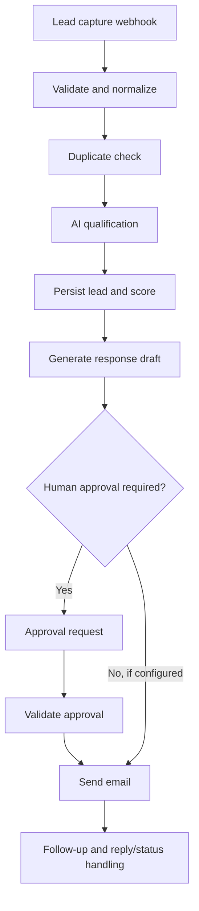

# AI Lead Response & Follow-up Automation

A combined n8n workflow for capturing inbound leads, validating and qualifying them with AI, generating an email draft, routing it through human approval, and managing follow-up and lead-status handling.

> Portfolio project: this repository contains a workflow export. Review the exact export and configure credentials before importing or activating it.

## At a glance

| Area | Implementation |
|---|---|
| Orchestration | n8n |
| AI qualification and drafting | Google Gemini via HTTP Request |
| Lead data | Google Sheets |
| Email | Gmail |
| Workflow export | `ai-lead-response-automation.json` — 119 nodes |

## Architecture

The diagram summarizes the intended business flow; confirm the enabled branches and behavior in the actual workflow export.

## Repository contents

- `ai-lead-response-automation.json` — combined 119-node workflow export.

## Requirements

- n8n with Webhook, Google Sheets, Gmail, Schedule Trigger, and HTTP Request nodes.
- Google Gemini API access.
- A Google Sheet with the columns referenced by the workflow.
- A dedicated test mailbox and a reachable n8n webhook URL.

## Setup and credential handling

1. Import the workflow JSON into n8n.
2. Configure Google Sheets and Gmail credentials using n8n's credential store.
3. Configure Gemini HTTP authentication using an n8n Header Auth credential (header name `x-goog-api-key`) or an approved secret-management mechanism.
4. Do **not** paste an API key into workflow JSON, expressions, README files, screenshots, or Git history.
5. Configure sheet references, owner notification address, booking URL, public n8n base URL, and webhook paths.
6. Review approval behavior, follow-up schedule, reply detection, opt-out handling, and Gmail trigger settings.
7. Test with a dedicated sheet and test mailbox before enabling any send path.

If an API key was previously committed or shared, treat it as exposed and rotate/revoke it. Removing a value from the current file does not remove it from Git history.

## Validation status

The repository contains a workflow export. This README does not claim production runtime verification. Before live use, test new leads, invalid inputs, duplicates, AI failures, approval-token validation, repeated approvals, replies, opt-outs, and follow-up scheduling.

A separate review of an approval/send working copy identified changes that should be reconciled with this published export before replacing it. Do not assume the review copy is already present in this repository.

## Limitations and next steps

- Google Sheets read/check/write sequences may not provide atomic protection against simultaneous approvals or follow-up sends.
- Provider credentials, spreadsheets, and deployed webhook URLs are not included.
- Add runtime test evidence and a redacted approval-to-send demo after verification.

## License

No license is specified. Contact the repository owner before reusing this project.
