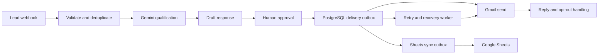

# AI Lead Response Automation

An approval-first lead response and follow-up system built with n8n, PostgreSQL, Google Sheets, Gmail, and Gemini. It is designed to help teams respond to new inquiries promptly while preserving human review and auditable delivery state.

## What it does

- Validates incoming lead data and prevents duplicate intake.
- Uses Gemini for qualification and response drafting.
- Requires an explicit human confirmation before an initial response is sent.
- Tracks reply and opt-out signals to stop further outreach.
- Stores delivery and retry state in PostgreSQL, with durable claims to prevent concurrent duplicate work.
- Synchronizes delivery state to Google Sheets through a retryable outbox.
- Schedules eligible follow-ups with bounded retry and recovery paths.

## Architecture

PostgreSQL is authoritative for transactional approval, delivery, retry, and synchronization claims. Sheets is an operational mirror. A Sheets synchronization failure must not itself cause another email send. Ambiguous email outcomes require reconciliation before retry.

## Repository contents

- `workflows/ai-lead-response-automation-173-node.json` — sanitized 173-node portfolio export. It has a fresh inactive workflow ID and no embedded n8n credential bindings. Its Gemini requests use the n8n HTTP Header Auth credential mode.
- `ai-lead-response-automation.json` — preserved 119-node published baseline. It is retained for historical comparison; see the security note below before importing it.
- `docs/SETUP.md` — prerequisites and configuration.
- `docs/SECURITY.md` — credential and workflow safety guidance.
- `docs/TESTING.md` — verified test scope and results.

## Technology

n8n workflow orchestration; PostgreSQL transactions and outboxes; Google Sheets for operational visibility; Gmail for approved email delivery; Gemini API for qualification and drafting.

## Verification status

- The isolated PostgreSQL synthetic suite passed 30 of 30 checks, including concurrency, retry, and recovery cases.
- A separate 37-node n8n synthetic harness exercised deterministic workflow logic with synthetic data and mocked provider responses.
- The 173-node Task 9O workflow was imported inactive into isolated n8n 2.22.6 and passed static structure and node-catalog checks.
- The complete 173-node workflow has not been executed end to end.
- Live Gemini, Google Sheets, and Gmail integrations have not been verified.
- The credential-based Gemini correction in the public 173-node export has not itself been imported or runtime-tested.
- This project is not a deployed production service.

See [Testing](docs/TESTING.md) for test classification and limits.

## Security note

The preserved 119-node baseline contains placeholder Gemini header parameters with a trailing-space header name. Do not replace those placeholders with a real API key. Use the 173-node export and store provider keys in n8n credentials. The credential change in that export remains pending engine verification.

No real provider credentials or customer records are included. The workflow exports are inactive. Do not activate them against real leads without isolated end-to-end testing and an explicit operational review.

## Getting started

Review [Setup](docs/SETUP.md) before importing. Configure isolated test credentials and database prerequisites in n8n, import inactive, and use synthetic leads and a test mailbox. The complete database bootstrap migration package is not included in this repository yet; see Setup for the schema prerequisite.

## License

No license is specified in this repository. Do not assume reuse rights beyond GitHub's default terms.
